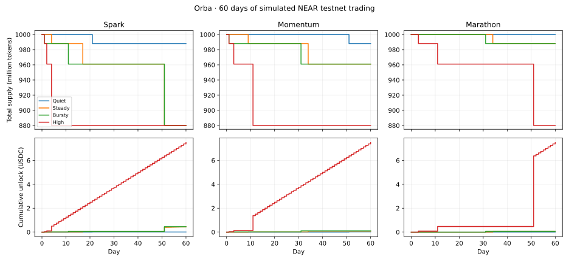

# Orba’s 60-day supply simulation

Every run starts with 1 billion tokens, including a 120 million token burn reserve. Quiet buys 0.50 USDC daily. Steady buys 3 USDC daily. Bursty buys 30 USDC on days 1, 11, 21, 31, 41, and 51. High buys 50 USDC daily. Steady and Bursty both spend 180 USDC, so the comparison isolates when purchases happen.

| Preset | Quiet | Steady | Bursty | High |
| --- | --- | --- | --- | --- |
| Spark | 988M · day 21 | 880M · days 4, 17, 51 | 880M · days 1, 11, 51 | 880M · days 1, 2, 4 |
| Momentum | 988M · day 51 | 961M · days 9, 34 | 961M · days 1, 31 | 880M · days 1, 3, 11 |
| Marathon | 1B · no burns | 988M · day 34 | 988M · day 31 | 880M · days 3, 11, 51 |

Each cell gives day 60 supply and the days burns occurred. Spark is the best fit for a short demo. Steady activity reaches all three milestones by day 51, while even Quiet activity shows one burn. Momentum spreads out the milestones, and Marathon needs considerably more activity.

Steady and Bursty finish with the same Spark supply and both unlock 0.45 USDC. Bursty reaches that amount on day 51. Steady reaches it on day 60 because fees from later trades become claimable as they settle.

The simulation uses integer base units, the current 1% fee split, and cumulative buy volume after fees. It assumes one buy per active day, successful settlement, and no sells, claims, or graduation. These are illustrative activity patterns. They do not estimate adoption or test wallet farming.

Run `python near/scripts/simulate-milestones.py` with Matplotlib installed to regenerate the chart and [daily CSV](simulation-60-day.csv).
